# Weather-Station Behaviour Grouping for Automated Data Quality Assessment

*Auto-generated from the executed analysis (`python run_pipeline.py`). All numbers below are read from files in `outputs/`.*

## Abstract
Daily observations from 138 Indian weather stations (NOAA Global Surface Summary of the Day, calendar year 2023; 49,818 cleaned station-days) were aggregated to station-level statistical features (17 clustering features) and grouped with K-Means. K = 5 was selected from the tested range K = 2–10 using silhouette, Davies-Bouldin, the elbow of WCSS, cluster size and two stability measures. At the selected K the Euclidean silhouette is 0.179 and the Davies-Bouldin index is 1.458. The clusters are exploratory groupings of annual observed behaviour and are not permanent categories or judgements of station reliability.

## 1. Introduction
Weather-station networks produce heterogeneous records: stations differ in climate, altitude, instrumentation and reporting completeness. Grouping stations by observed behaviour can support screening and comparison when assessing data quality, without labelled reference categories.

## 2. Problem statement
Given daily records of many stations, can stations be grouped by similarity of their observed weather behaviour in a reproducible, validated way, and are the groups stable and interpretable?

## 3. Objectives
1. Prepare and preprocess an open NOAA station dataset for clustering.
2. Build a K-Means workflow over multiple K with Euclidean/Manhattan comparison, WCSS, silhouette, Davies-Bouldin, elbow and PCA.
3. Interpret and validate the clusters (profiles, stability, feature contributions, limitations).
4. Deliver a reproducible end-to-end analysis.

## 4. Dataset
NOAA NCEI **Global Surface Summary of the Day (GSOD)**, derived from the Integrated Surface Hourly dataset. Landing page: https://www.ncei.noaa.gov/access/metadata/landing-page/bin/iso?id=gov.noaa.ncdc:C00516 ; files: https://www.ncei.noaa.gov/data/global-summary-of-the-day/access/2023/<station>.csv ; station metadata: https://www.ncei.noaa.gov/pub/data/noaa/isd-history.csv ; documentation: https://www.ncei.noaa.gov/data/global-summary-of-the-day/doc/readme.txt . Stations of India (FIPS `IN`) whose ISD record spans the whole year were downloaded by `src/data_preprocessing.py`. Each row is one station-day; variables include mean/max/min temperature, dew point, sea-level and station pressure, visibility, wind speed, peak wind, precipitation and a fog/rain/snow/hail/thunder/tornado flag string. The **clustering unit is the station**, so daily records are aggregated.

## 5. Methodology
Pipeline: download → clean daily records → derive variables → aggregate per station → select features → impute → scale → K-Means/K-Medians for K = 2–10 → validation → selection → profiling → stability → feature contribution. Random seed: 42.

## 6. Data preprocessing
Every cleaning step and its count:

| step | count | note |
|---|---|---|
| raw daily records | 49818 | rows read from station files |
| unparseable dates removed | 0 | rows |
| duplicate station-days removed | 0 | rows (same STATION and DATE) |
| TEMP: missing-value sentinel -> NaN | 0 | values >= 9999.9 |
| DEWP: missing-value sentinel -> NaN | 42 | values >= 9999.9 |
| SLP: missing-value sentinel -> NaN | 15663 | values >= 9999.9 |
| STP: missing-value sentinel -> NaN | 0 | values >= 9999.9 |
| VISIB: missing-value sentinel -> NaN | 0 | values >= 999.9 |
| WDSP: missing-value sentinel -> NaN | 332 | values >= 999.9 |
| MXSPD: missing-value sentinel -> NaN | 4385 | values >= 999.9 |
| GUST: missing-value sentinel -> NaN | 48577 | values >= 999.9 |
| MAX: missing-value sentinel -> NaN | 2 | values >= 9999.9 |
| MIN: missing-value sentinel -> NaN | 4 | values >= 9999.9 |
| PRCP: missing-value sentinel -> NaN | 1300 | values >= 99.99 |
| SNDP: missing-value sentinel -> NaN | 49818 | values >= 999.9 |
| PRCP flag 'I' (no precipitation report) -> NaN | 31113 | treated as missing |
| PRCP flag 'H' (0 reported, but precipitation seen in hourly obs) -> NaN | 28 | ambiguous/incomplete day: not a confirmed dry day; counted separately as dq_prcp_flag_h_frac |
| stp_hpa: implausible value -> NaN | 1246 | outside [300, 1100] |
| daily max < daily min -> both NaN | 0 | inconsistent record |
| dew point > temperature + 0.5 C -> dew point NaN | 0 | physically inconsistent |
| clean daily records kept | 49818 | rows (outliers are not removed unless implausible) |

Decisions: GSOD missing-value sentinels were converted to NaN; units converted to SI; physically implausible values and internally inconsistent records (max < min, dew point > temperature) set to missing. Precipitation attribute **I** (no precipitation report) is treated as missing. Attribute **H** (station reported 0 for the day, but hourly observations reported precipitation) is handled separately: per NOAA it is incomplete data, so it is *not* treated as a confirmed dry day and is excluded from precipitation calculations; its frequency per station is kept as the data-quality feature `dq_prcp_flag_h_frac`. Outliers that are physically plausible were **kept** (genuine extremes carry weather information) and screened with boxplots (Fig. 4). Daily missing percentages: Fig. 1.

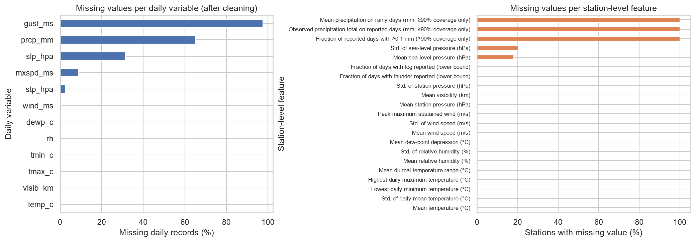

*Figure 1. Missing values*

## 7. Feature engineering and aggregation
Derived daily: relative humidity (Magnus formula from temperature and dew point), diurnal temperature range, dew-point depression, fog/thunder/rain-day indicators. Per station: mean, standard deviation and extremes of the daily series, observed precipitation total, rainy-day fraction and intensity, and reported fog/thunder frequency.

**Precipitation.** A partial precipitation record is *not* scaled up to 365 days, because nothing shows that missing days are representative (missing days may be unreported dry days or wet days with accumulated reports). For each station, precipitation coverage = valid PRCP days / calendar days. The precipitation features (`precip_observed_total_mm`, `rainy_day_frac`, `precip_intensity_mm`) are computed from valid days only and are set to **unavailable (NaN)** when coverage is below 90%; 138 of 138 retained stations are unavailable. Even above the threshold the total is an *observed total on reported days*, a lower bound rather than an annual estimate. Features unavailable for more than 40% of stations are dropped; otherwise remaining gaps are median-imputed, which must be kept in mind when interpreting precipitation differences.

**Event indicators.** In GSOD the FRSHTT digits are 1 = event reported and 0 = *no event or not reported*; zero is not confirmed absence. The features are named `fog_reported_frac` and `thunder_reported_frac` and are interpreted as lower bounds that also reflect station reporting practice. The variant analysis includes a run without them.

**Station completeness rule.** Stations with fewer than 250 valid temperature days were removed (37 stations); see Section 7.1. Latitude, longitude, elevation and station name were **excluded from clustering** (identifiers/context) and used only for interpretation. No categorical variables remain after aggregation, so no encoding was needed. Missing station-level values were median-imputed and features were standardised (zero mean, unit variance) because K-Means is distance-based.

### 7.1 Effect of the completeness exclusion
Of 175 stations with daily records, **37** were excluded because they reported a valid mean temperature on fewer than 250 days (138 retained).

Excluded stations: median valid temperature days = 1 (range 1–240); mean latitude 22.8°N vs 24.0°N retained; mean elevation 360 m vs 370 m retained (full list: `outputs/metrics/excluded_stations.csv`).

Sensitivity of the rule to the threshold:

| min_valid_temp_days | stations_kept | stations_excluded |
|---|---|---|
| 150 | 141 | 34 |
| 200 | 140 | 35 |
| 250 | 138 | 37 |
| 300 | 129 | 46 |
| 330 | 119 | 56 |

**Selection bias and implications.** The rule keeps only stations that report temperature almost every day. Clusters therefore describe *well-reporting* stations only; stations with the poorest completeness — the ones an automated data-quality screen would most want to flag — are removed before clustering and cannot be assigned to any group. Completeness correlates with network type, region, instrumentation and station status, so the retained set is not a random sample and the clusters should not be generalised to the whole network. Completeness itself is not part of the baseline features; the variant that adds data-completeness features shows how much the grouping changes when it is included. A data-quality application would need either a separate completeness screen before clustering or a design that retains incomplete stations.

Feature selection log (features missing for > 40% of stations or with |r| > 0.97 to an earlier feature are dropped):

| feature | decision | reason |
|---|---|---|
| precip_observed_total_mm | dropped | 100% of stations missing (> 40%) |
| rainy_day_frac | dropped | 100% of stations missing (> 40%) |
| precip_intensity_mm | dropped | 100% of stations missing (> 40%) |
| temp_mean | kept | 0% missing -> median-imputed |
| temp_std | kept | 0% missing -> median-imputed |
| temp_min | kept | 0% missing -> median-imputed |
| temp_max | kept | 0% missing -> median-imputed |
| dtr_mean | kept | 0% missing -> median-imputed |
| rh_mean | kept | 0% missing -> median-imputed |
| rh_std | kept | 0% missing -> median-imputed |
| dewp_dep_mean | dropped | |r| = 0.993 with rh_mean (> 0.97) |
| wind_mean | kept | 0% missing -> median-imputed |
| wind_std | kept | 0% missing -> median-imputed |
| wind_peak | kept | 0% missing -> median-imputed |
| slp_mean | kept | 18% missing -> median-imputed |
| slp_std | kept | 20% missing -> median-imputed |
| stp_mean | kept | 0% missing -> median-imputed |
| stp_std | kept | 0% missing -> median-imputed |
| visib_mean | kept | 0% missing -> median-imputed |
| fog_reported_frac | kept | 0% missing -> median-imputed |
| thunder_reported_frac | kept | 0% missing -> median-imputed |

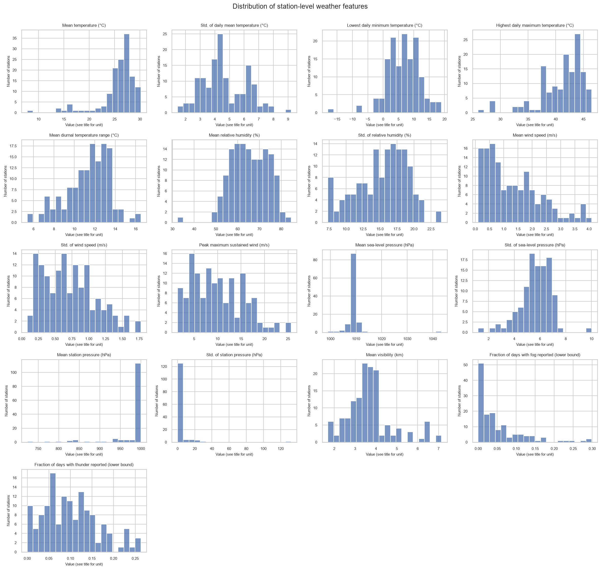

*Figure 2. Feature distributions*

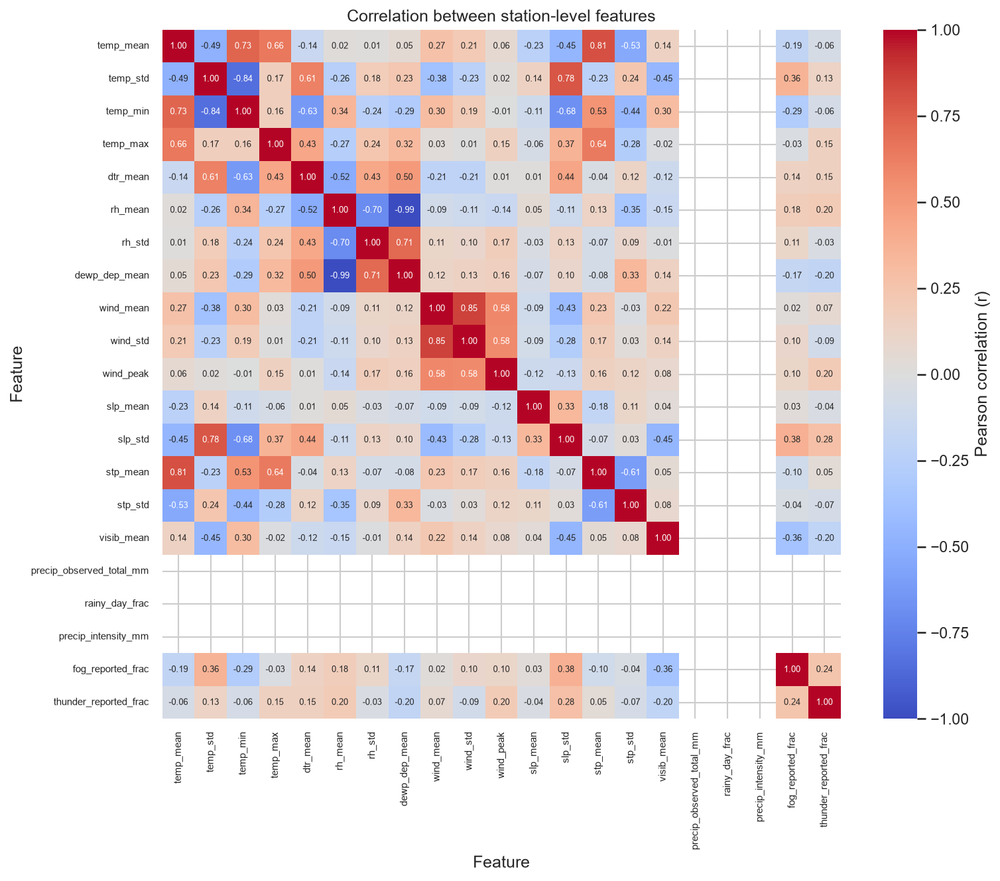

*Figure 3. Correlation heatmap*

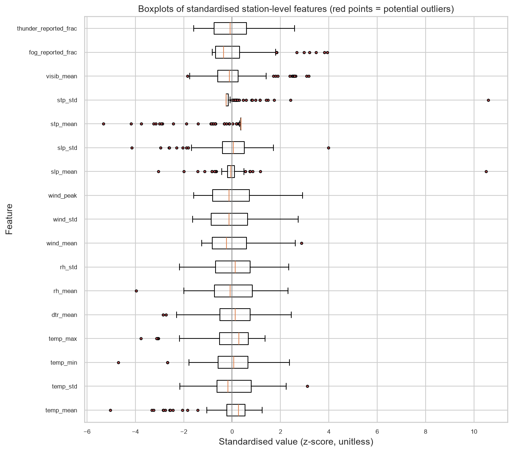

*Figure 4. Boxplots of standardised features*

## 8. Clustering methodology and distance metrics
Standard K-Means (scikit-learn, `n_init=20`) minimises the within-cluster sum of squares (WCSS) with **Euclidean** distance. It does **not** support Manhattan distance. Manhattan distance was therefore used in two clearly separate ways: (a) **evaluation only** — Manhattan silhouette computed on the K-Means labels (the clustering itself is unchanged); (b) **a different algorithm** — K-Medians (own implementation in `src/clustering.py`), which assigns by Manhattan distance and updates centres with medians. Davies-Bouldin is computed with scikit-learn (Euclidean, cluster means) for both algorithms. The K-Medians objective is an L1 cost and is not comparable to WCSS.

## 9. Evaluation across K
| method | k | objective | silhouette_euclidean | silhouette_manhattan | davies_bouldin | min_size |
|---|---|---|---|---|---|---|
| kmeans | 2 | 1953.084 | 0.168 | 0.193 | 2.046 | 65 |
| kmeans | 3 | 1651.470 | 0.197 | 0.215 | 1.679 | 12 |
| kmeans | 4 | 1483.245 | 0.183 | 0.197 | 1.602 | 12 |
| kmeans | 5 | 1332.273 | 0.179 | 0.191 | 1.458 | 11 |
| kmeans | 6 | 1184.843 | 0.184 | 0.188 | 1.300 | 1 |
| kmeans | 7 | 1057.150 | 0.192 | 0.202 | 1.109 | 1 |
| kmeans | 8 | 989.854 | 0.179 | 0.189 | 1.239 | 1 |
| kmeans | 9 | 918.332 | 0.180 | 0.187 | 1.279 | 1 |
| kmeans | 10 | 880.184 | 0.174 | 0.163 | 1.276 | 1 |
| kmedians | 2 | 1420.756 | 0.178 | 0.201 | 1.995 | 43 |
| kmedians | 3 | 1303.521 | 0.145 | 0.169 | 2.120 | 41 |
| kmedians | 4 | 1210.131 | 0.158 | 0.192 | 1.783 | 12 |
| kmedians | 5 | 1142.050 | 0.171 | 0.190 | 1.530 | 12 |
| kmedians | 6 | 1084.016 | 0.159 | 0.180 | 1.596 | 12 |
| kmedians | 7 | 1054.416 | 0.143 | 0.157 | 1.590 | 12 |
| kmedians | 8 | 1020.538 | 0.123 | 0.149 | 1.658 | 11 |
| kmedians | 9 | 994.430 | 0.150 | 0.172 | 1.672 | 1 |
| kmedians | 10 | 961.981 | 0.126 | 0.150 | 1.740 | 5 |

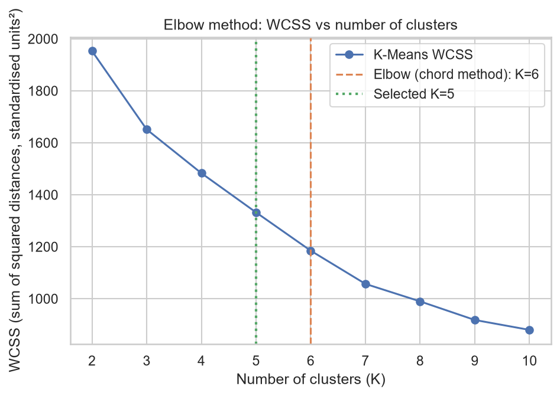

*Figure 5. Elbow curve*

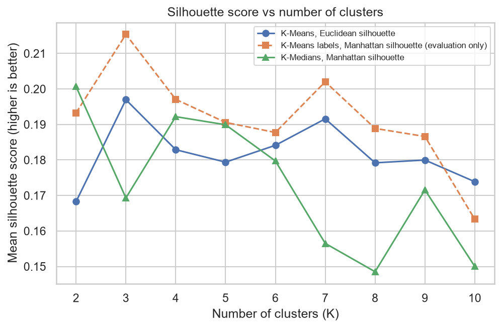

*Figure 6. Silhouette vs K*

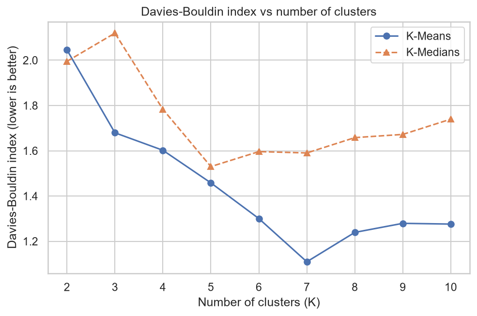

*Figure 7. Davies-Bouldin vs K*

Best K by Euclidean silhouette: **3**; best K by Davies-Bouldin: **7**; elbow K (chord method): **6**; selected K (composite incl. stability): **5**. The indices do not agree. This is expected: WCSS always decreases with K and its elbow is a visual/heuristic criterion, silhouette rewards compact and well separated groups, and Davies-Bouldin penalises overlap between the most similar pair of clusters. The final K was therefore chosen with the composite score (silhouette, Davies-Bouldin, two stability measures, minimum cluster size) rather than any single index.

K-Means vs K-Medians label agreement (ARI):

| k | ari | nmi |
|---|---|---|
| 2 | 0.196 | 0.223 |
| 3 | 0.295 | 0.343 |
| 4 | 0.431 | 0.569 |
| 5 | 0.764 | 0.783 |
| 6 | 0.484 | 0.628 |
| 7 | 0.405 | 0.625 |
| 8 | 0.530 | 0.673 |
| 9 | 0.492 | 0.675 |
| 10 | 0.455 | 0.674 |

### Composite selection table (K-Means)
| k | silhouette_euclidean | davies_bouldin | seed_ari_mean | boot_ari_mean | min_size | min_ok | eligible | is_elbow_k | score |
|---|---|---|---|---|---|---|---|---|---|
| 2 | 0.168 | 2.046 | 0.462 | 0.630 | 65 | True | False | False |  |
| 3 | 0.197 | 1.679 | 0.487 | 0.856 | 12 | True | True | False | 0.500 |
| 4 | 0.183 | 1.602 | 0.498 | 0.591 | 12 | True | True | False | 0.270 |
| 5 | 0.179 | 1.458 | 0.508 | 0.641 | 11 | True | True | False | 0.547 |
| 6 | 0.184 | 1.300 | 0.546 | 0.671 | 1 | False | False | True |  |
| 7 | 0.192 | 1.109 | 0.590 | 0.686 | 1 | False | False | False |  |
| 8 | 0.179 | 1.239 | 0.502 | 0.622 | 1 | False | False | False |  |
| 9 | 0.180 | 1.279 | 0.527 | 0.671 | 1 | False | False | False |  |
| 10 | 0.174 | 1.276 | 0.502 | 0.591 | 1 | False | False | False |  |

K = 2 is excluded as a final choice because a two-way split is rarely informative; clusters smaller than max(3, 5% of stations) make a K ineligible.

## 10. PCA visualisation
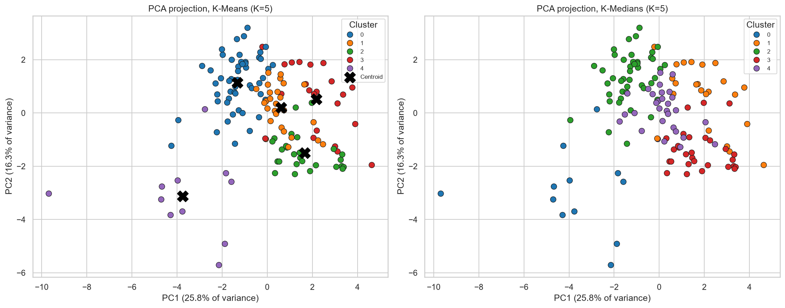

*Figure 8. PCA projection of the selected clustering (left) and K-Medians (right)*

PCA is used only for visual inspection; clustering was done in the full standardised feature space. Overlap in two dimensions does not imply overlap in the full space.

## 11. Results and cluster interpretation (K = 5)
Cluster sizes:

| cluster | n_stations | share |
|---|---|---|
| 0 | 51 | 0.370 |
| 1 | 27 | 0.196 |
| 2 | 27 | 0.196 |
| 3 | 22 | 0.159 |
| 4 | 11 | 0.080 |

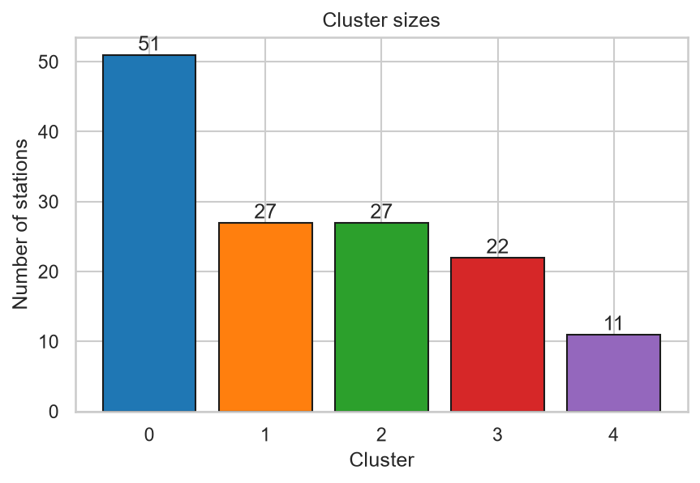

*Figure 9. Cluster sizes*

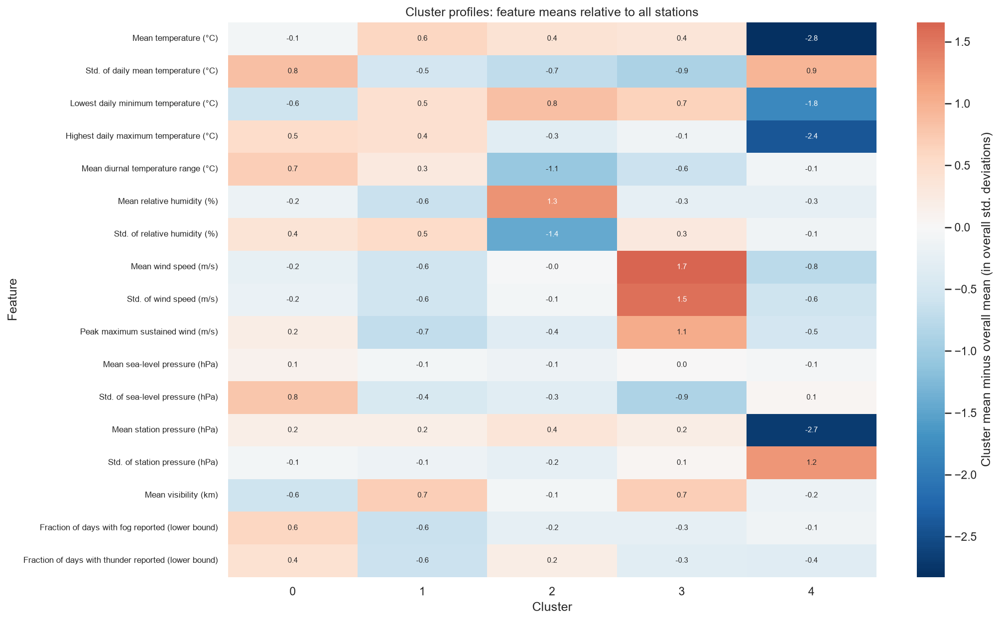

*Figure 10. Cluster profile heatmap*

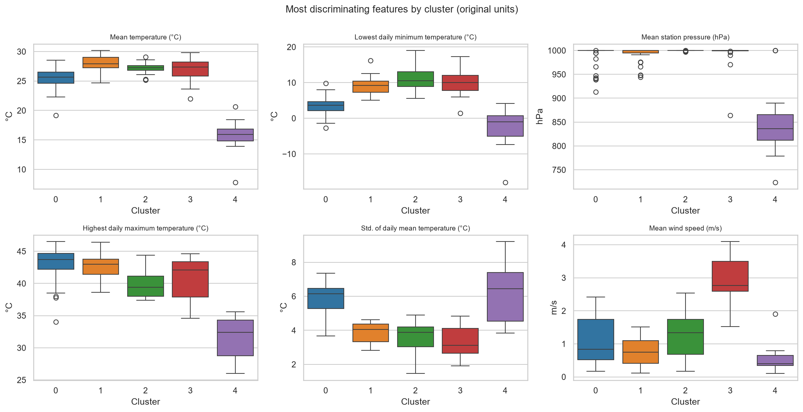

*Figure 11. Cluster comparison*

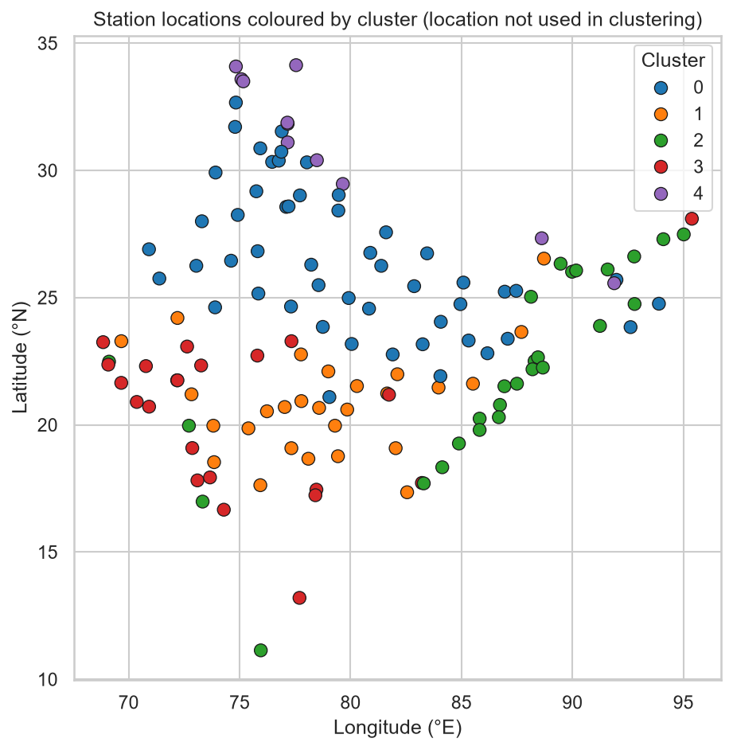

*Figure 13. Station locations by cluster (supplementary)*

**Cluster 0** — 51 stations (37%). Most distinguishing features: Std. of daily mean temperature (°C): 5.86 vs 4.63 overall (z = +0.83); Std. of sea-level pressure (hPa): 6.54 vs 5.68 overall (z = +0.78); Mean diurnal temperature range (°C): 12.86 vs 11.38 overall (z = +0.71); Fraction of days with fog reported (lower bound): 0.09 vs 0.05 overall (z = +0.60). Mean latitude 26.5°N, mean elevation 310 m (descriptive only, not used for clustering). Example stations: Jammu, In, Amritsar, In, Sundernagar, In, Ludhiana, In, Patiala, In.

**Cluster 1** — 27 stations (20%). Most distinguishing features: Mean visibility (km): 4.46 vs 3.70 overall (z = +0.70); Peak maximum sustained wind (m/s): 6.30 vs 10.02 overall (z = -0.69); Mean relative humidity (%): 60.09 vs 65.35 overall (z = -0.63); Fraction of days with fog reported (lower bound): 0.01 vs 0.05 overall (z = -0.63). Mean latitude 20.9°N, mean elevation 317 m (descriptive only, not used for clustering). Example stations: Jalpaiguri, In, Deesa, In, Bhuj, In, Shanti Niketan, In, Hoshangabad, In.

**Cluster 2** — 27 stations (20%). Most distinguishing features: Std. of relative humidity (%): 10.01 vs 15.37 overall (z = -1.44); Mean relative humidity (%): 75.87 vs 65.35 overall (z = +1.27); Mean diurnal temperature range (°C): 9.14 vs 11.38 overall (z = -1.06); Lowest daily minimum temperature (°C): 11.06 vs 6.62 overall (z = +0.85). Mean latitude 22.2°N, mean elevation 65 m (descriptive only, not used for clustering). Example stations: Lilabari, In, Dibrugarh, In, Cooch Behar, In, Dhubri, In, Guwahati International, In.

**Cluster 3** — 22 stations (16%). Most distinguishing features: Mean wind speed (m/s): 2.91 vs 1.31 overall (z = +1.66); Std. of wind speed (m/s): 1.31 vs 0.72 overall (z = +1.54); Peak maximum sustained wind (m/s): 15.70 vs 10.02 overall (z = +1.06); Std. of daily mean temperature (°C): 3.33 vs 4.63 overall (z = -0.89). Mean latitude 20.6°N, mean elevation 271 m (descriptive only, not used for clustering). Example stations: Bhavnagar, In, Pasighat, In, Naliya, In, Ahmedabad, In, Bhopal, In.

**Cluster 4** — 11 stations (8%). Most distinguishing features: Mean temperature (°C): 15.66 vs 25.75 overall (z = -2.83); Mean station pressure (hPa): 851.03 vs 981.70 overall (z = -2.69); Highest daily maximum temperature (°C): 31.42 vs 41.08 overall (z = -2.42); Lowest daily minimum temperature (°C): -2.87 vs 6.62 overall (z = -1.81). Mean latitude 31.2°N, mean elevation 1725 m (descriptive only, not used for clustering). Example stations: Srinagar, In, Qazi Gund, In, Banihal, In, Bhuntar, In, Shimla, In.

*These descriptions are generated automatically from the calculated profiles (`outputs/cluster_profiles/`). They describe how groups differ in observed statistics; they do not rank weather quality or station reliability.*

### Feature contributions
Between-cluster separation (eta², ANOVA F, Kruskal-Wallis H; p-values are descriptive because clusters were derived from the same data):

| feature | eta_squared | anova_F | anova_p | kruskal_H | kruskal_p |
|---|---|---|---|---|---|
| temp_mean | 0.764 | 107.576 | 0.000 | 64.160 | 0.000 |
| temp_min | 0.638 | 58.661 | 0.000 | 94.223 | 0.000 |
| stp_mean | 0.631 | 56.931 | 0.000 | 29.735 | 0.000 |
| temp_max | 0.624 | 55.220 | 0.000 | 58.438 | 0.000 |
| temp_std | 0.607 | 51.314 | 0.000 | 86.596 | 0.000 |
| wind_mean | 0.567 | 43.588 | 0.000 | 58.261 | 0.000 |
| rh_std | 0.532 | 37.826 | 0.000 | 62.444 | 0.000 |
| wind_std | 0.480 | 30.701 | 0.000 | 53.385 | 0.000 |
| dtr_mean | 0.477 | 30.345 | 0.000 | 72.088 | 0.000 |
| rh_mean | 0.418 | 23.893 | 0.000 | 61.703 | 0.000 |
| slp_std | 0.407 | 22.807 | 0.000 | 71.292 | 0.000 |
| wind_peak | 0.336 | 16.861 | 0.000 | 45.704 | 0.000 |
| visib_mean | 0.302 | 14.410 | 0.000 | 44.239 | 0.000 |
| fog_reported_frac | 0.233 | 10.128 | 0.000 | 52.803 | 0.000 |
| thunder_reported_frac | 0.176 | 7.084 | 0.000 | 26.844 | 0.000 |
| stp_std | 0.141 | 5.480 | 0.000 | 22.887 | 0.000 |
| slp_mean | 0.010 | 0.348 | 0.845 | 4.148 | 0.386 |

Leave-one-feature-out (ARI of the clustering without the feature vs the baseline; lower = more influential):

| feature_removed | ari_vs_baseline | silhouette |
|---|---|---|
| temp_std | 0.347 | 0.182 |
| rh_std | 0.493 | 0.175 |
| visib_mean | 0.532 | 0.165 |
| thunder_reported_frac | 0.611 | 0.213 |
| fog_reported_frac | 0.619 | 0.218 |
| dtr_mean | 0.653 | 0.191 |
| wind_std | 0.692 | 0.193 |
| temp_max | 0.696 | 0.175 |
| stp_mean | 0.711 | 0.177 |
| temp_mean | 0.726 | 0.175 |
| wind_mean | 0.743 | 0.186 |
| stp_std | 0.747 | 0.182 |
| rh_mean | 0.747 | 0.190 |
| wind_peak | 0.766 | 0.204 |
| temp_min | 0.772 | 0.180 |
| slp_std | 0.775 | 0.183 |
| slp_mean | 0.982 | 0.192 |

## 12. Stability analysis
At the selected K: seed-to-seed ARI = 0.508 ± 0.122; subsample-refit ARI = 0.641 ± 0.105.

| k | seed_ari_mean | seed_ari_std | boot_ari_mean | boot_ari_std |
|---|---|---|---|---|
| 2 | 0.462 | 0.382 | 0.630 | 0.330 |
| 3 | 0.487 | 0.222 | 0.856 | 0.103 |
| 4 | 0.498 | 0.171 | 0.591 | 0.116 |
| 5 | 0.508 | 0.122 | 0.641 | 0.105 |
| 6 | 0.546 | 0.132 | 0.671 | 0.166 |
| 7 | 0.590 | 0.101 | 0.686 | 0.140 |
| 8 | 0.502 | 0.089 | 0.622 | 0.127 |
| 9 | 0.527 | 0.098 | 0.671 | 0.117 |
| 10 | 0.502 | 0.099 | 0.591 | 0.096 |

Agreement between consecutive K:

| k_from | k_to | ari | nmi |
|---|---|---|---|
| 2 | 3 | 0.399 | 0.431 |
| 3 | 4 | 0.597 | 0.644 |
| 4 | 5 | 0.673 | 0.732 |
| 5 | 6 | 0.755 | 0.828 |
| 6 | 7 | 0.719 | 0.756 |
| 7 | 8 | 0.708 | 0.812 |
| 8 | 9 | 0.854 | 0.906 |
| 9 | 10 | 0.516 | 0.693 |

Preprocessing/feature-set variants (ARI vs baseline at K = 5):

| variant | n_features | ari_vs_baseline | silhouette |
|---|---|---|---|
| robust scaler | 17 | 0.057 | 0.799 |
| KNN imputation | 17 | 0.761 | 0.180 |
| log1p on precipitation | 17 | 1.000 | 0.179 |
| no pressure features | 13 | 0.789 | 0.211 |
| no extreme-value features | 14 | 0.611 | 0.204 |
| no event-report features | 15 | 0.605 | 0.230 |
| no precipitation features | 17 | 1.000 | 0.179 |
| plus data-completeness features | 25 | 0.442 | 0.161 |

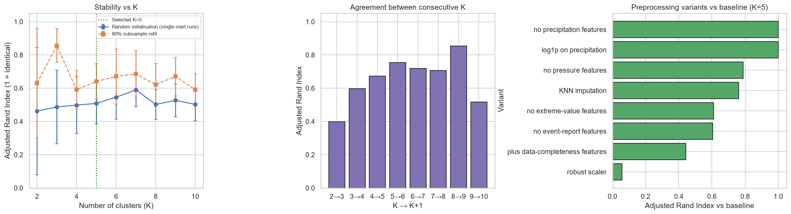

*Figure 12. Stability analysis*

## 13. Limitations and potential bias
- One year (2023) of data; inter-annual variability is not captured and clusters may change in another year.
- Only stations present in NOAA's ISD/GSOD with sufficient reporting are included; the network is not a random sample of Indian stations and is denser in some regions.
- Median imputation and standardisation affect distances; the variant analysis shows the sensitivity at K = 5.
- K-Means favours compact, similarly sized, roughly spherical groups; real climate regimes can be continuous.
- Features derived from GSOD (e.g. relative humidity from dew point) inherit upstream measurement and rounding errors; pressure features are strongly tied to elevation.
- ANOVA/Kruskal p-values are not valid hypothesis tests after clustering.

## 14. Responsible use
Clusters are exploratory groupings of observed behaviour in one year, not permanent station categories, and must not be read as measures of weather quality, instrument accuracy or station reliability. Any operational data-quality use requires expert review, metadata (instrument type, siting), and validation against independent references.

## 15. Conclusion
The workflow produced a validated K = 5 grouping of 138 stations; the evidence (metrics, stability, interpretability) is summarised in Sections 9–12. See `README.md` to reproduce.

## 16. References
- NOAA NCEI, Global Surface Summary of the Day (GSOD). https://www.ncei.noaa.gov/access/metadata/landing-page/bin/iso?id=gov.noaa.ncdc:C00516
- NOAA NCEI, Integrated Surface Database station history. https://www.ncei.noaa.gov/pub/data/noaa/isd-history.csv
- Pedregosa et al. (2011). Scikit-learn: Machine Learning in Python. JMLR 12, 2825–2830.
- Rousseeuw, P. J. (1987). Silhouettes. J. Comput. Appl. Math. 20, 53–65.
- Davies, D. L. & Bouldin, D. W. (1979). A cluster separation measure. IEEE TPAMI 1(2), 224–227.
- Hubert, L. & Arabie, P. (1985). Comparing partitions. J. Classification 2, 193–218.
- Bradley, P. S., Mangasarian, O. L. & Street, W. N. (1997). Clustering via concave minimization (K-Medians).
